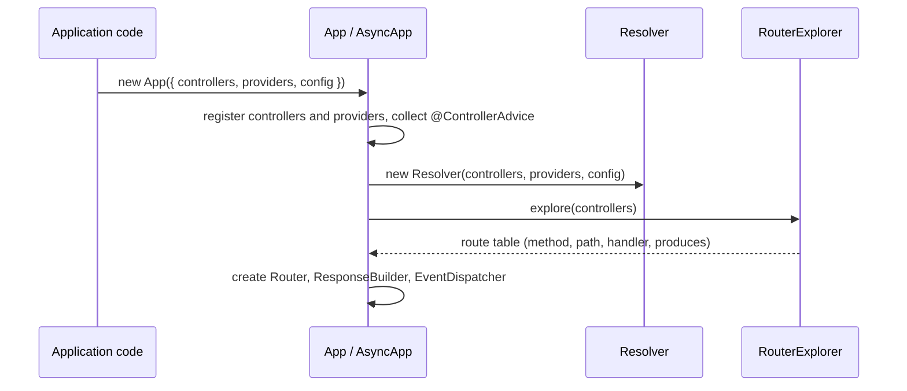
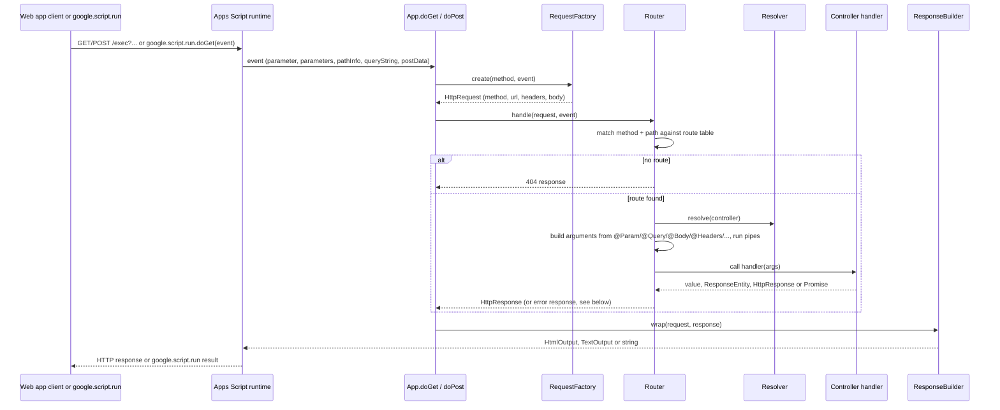
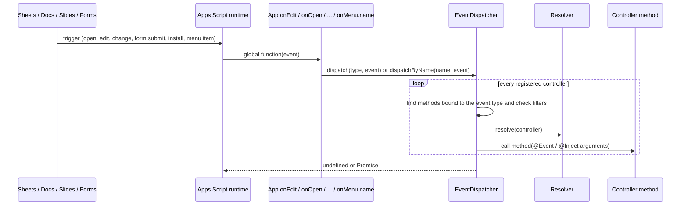

# Design

[← Back to README](../README.md) · [Documentation index](guide/README.md)

This page describes how **Boot.gs** is put together: who interacts with it, which components it consists of and
what happens on each kind of call. It describes the code in [`src/`](../src/) as of version 1.10.x.

## Actors

| Actor                  | What it does                                                                                                                                                                             |
| :--------------------- | :--------------------------------------------------------------------------------------------------------------------------------------------------------------------------------------- |
| Application developer  | Writes controllers, services and pipes with Boot.gs decorators, creates the application object and delegates the global Apps Script entry points (`doGet`, `doPost`, `onOpen`, …) to it. |
| Apps Script runtime    | Google's V8 runtime. Loads the bundled script, calls the global entry points with an event object and turns the returned `HtmlOutput`/`TextOutput` into an HTTP response.                |
| Web app client         | Anyone allowed by the web app deployment settings who sends `GET`/`POST` requests to the `/exec` URL (browser, webhook, other service).                                                  |
| Client-side page       | Sidebar, dialog or web app page served by `HtmlService` that calls server functions with `google.script.run`.                                                                            |
| Workspace event source | Google Sheets, Docs, Slides or Forms firing simple or installable triggers (open, edit, change, form submit, add-on install) and custom menu items.                                      |
| Add-on / document user | The person whose Google account runs the script and who granted its OAuth scopes.                                                                                                        |

Boot.gs itself has no network listener, storage or credentials. It runs entirely inside one Apps Script execution
and only transforms the event it is given into a call of application code and back.

## Components

| Component                                                                                                                | Responsibility                                                                                                                                                                                                                                                  |
| :----------------------------------------------------------------------------------------------------------------------- | :-------------------------------------------------------------------------------------------------------------------------------------------------------------------------------------------------------------------------------------------------------------- |
| `BootApplication` (`App`), `AsyncBootApplication` (`AsyncApp`), `BootApplicationFactory` (`createApp`, `createAsyncApp`) | Public entry objects. `App` returns results synchronously (or a `Promise` if a handler returns one); `AsyncApp` always returns a `Promise`. Both expose `doGet`, `doPost`, `onInstall`, `onOpen`, `onEdit`, `onChange`, `onFormSubmit` and `onMenu`.            |
| `BaseBootApplication`                                                                                                    | Shared constructor: registers controllers and providers from `ApplicationConfig`, collects `@ControllerAdvice` classes and wires the services below.                                                                                                            |
| Decorators (`src/controller/decorators`)                                                                                 | Write metadata with `reflect-metadata`: controller type and base path, route path and method, parameter sources, pipes, injection tokens, response status, `@ResponseBody`, exception handlers, Apps Script event bindings.                                     |
| `RouterExplorer`                                                                                                         | At startup, walks the prototypes of controllers marked as `http` (`@HttpController`, `@RestController`) and builds the route table (`RouteMetadata`).                                                                                                           |
| `RequestFactory`                                                                                                         | Turns a `doGet`/`doPost` event into an `HttpRequest`: method, path, query, virtual headers and body.                                                                                                                                                            |
| `Router` with `PathMatcher`                                                                                              | Finds the route for the request, resolves the controller, builds handler arguments, runs pipes, calls the handler and maps the result or the error to an `HttpResponse`.                                                                                        |
| `Resolver`                                                                                                               | Dependency injection container: creates controllers, `@Injectable`/`@Service`/`@Repository` classes and pipes on first use from constructor parameter types or `@Inject` tokens, resolves `@Value` keys from `config`, caches instances per application object. |
| Pipes (`src/controller/decorators/params/pipes`, `src/controller/decorators/validation/pipes`)                           | Transform or validate one argument: `Parse*Pipe` convert types, validation pipes (`@Min`, `@Max`, `@Size`, `@Pattern`, `@Email`, `@NotEmpty`, `@NotBlank`, …) throw an `Error` when the value is invalid.                                                       |
| `ResponseBuilder`                                                                                                        | Creates `HttpResponse` objects (status, status text, headers, body) and wraps them into `HtmlOutput` (`HtmlService`), `TextOutput` (`ContentService`) or a plain string.                                                                                        |
| `EventDispatcher`                                                                                                        | Calls controller methods bound to Apps Script events (`@OnOpen`, `@OnEdit`, `@OnChange`, `@OnFormSubmit`, `@OnInstall`) or to a menu action name, with optional filters (range, form id, change type).                                                          |
| `AppException`, `HttpException`                                                                                          | Base exceptions carrying an HTTP status, used by the error path of the router.                                                                                                                                                                                  |

Runtime dependencies are `reflect-metadata` and `apps-script-utils` (type guards and helpers); see
[Dependencies](../CONTRIBUTING.md#dependencies).

## Startup

The application object is normally created inside each global entry point, so startup runs once per Apps Script
execution.

No instance is created at startup: controllers, services and pipes are built by the `Resolver` the first time a
request or event needs them.

## HTTP request (`doGet` / `doPost`)

Details of each step:

1. **Request creation** (`RequestFactory`).
   - Method: the `method` request parameter, if it is a known `RequestMethod`, otherwise the entry point
     (`GET` for `doGet`, `POST` for `doPost`).
   - Path: `event.pathInfo`, else the `path` or `pathname` parameter, else `/`; normalised and passed through
     `decodeURI`.
   - Query: `event.parameters` as provided by Apps Script (each value is an array of strings).
   - Headers: the `headers` request parameter parsed as a JSON object; real HTTP request headers are not available
     to Apps Script web apps.
   - Body: for `POST`, `PUT`, `PATCH` and `DELETE`, `postData.contents`, parsed with `JSON.parse` when the virtual
     `Content-Type` header or `postData.type` contains `application/json`, otherwise the raw string.
2. **Route matching** (`Router`, `PathMatcher`). The first route with the same method and the same number of path
   segments whose literal segments are equal wins. `{name}` segments match any value and become path variables.
   Matching uses string splitting on `/`, not regular expressions.
3. **Argument resolution.** For every decorated parameter the router reads its source: path variable, query
   parameter (single-element arrays are unwrapped), body or body field, virtual header (case-insensitive), the raw
   event, the request, the response draft, a `@Value` config key or an `@Inject` dependency. Pipes run in order:
   controller `@UsePipes`, method `@UsePipes`, then the parameter's own pipes. Undecorated parameters stay
   `undefined`.
4. **Handler call.** The handler is called with the arguments. If it returns a `Promise`, the rest of the chain
   continues when it settles.
5. **Result mapping.** An `HttpResponse` is used as is; a `ResponseEntity` supplies status, headers, body and
   content type; any other value becomes the body with the `@ResponseStatus` status or the default (`200` for
   `GET`/`HEAD`/`OPTIONS`, `201` otherwise). Non-2xx bodies are wrapped as `{ error: ... }`.
6. **Response wrapping** (`ResponseBuilder.wrap`). The content type is the route's `produces` value, `text/html`
   by default.
   - With the virtual header `X-Request-Source: internal` (used with `google.script.run`) the result is a JSON
     string.
   - A handler that returns an `HtmlOutput` or `TextOutput` gets it passed through unchanged.
   - Otherwise the payload is serialised with `JSON.stringify` — the full `HttpResponse` envelope, or only the body
     when `@ResponseBody`/`@RestController` applies — and returned through `HtmlService.createHtmlOutput` for
     `text/html` or `ContentService.createTextOutput` with the matching MIME type for the other content types.

## `google.script.run` calls

`google.script.run` can call any global server function. With Boot.gs the client calls `doGet` or `doPost` with an
event object it builds itself (`pathInfo`, `parameter`, `parameters`, `queryString`) and usually sets the virtual
header `X-Request-Source: internal`. From there the flow is the same as an HTTP request; the result is returned to the
client's success handler as a JSON string of the `HttpResponse`. See
[Calling the API](guide/virtual-transport-layer.md).

## Workspace events and menus

- `dispatch` calls every method bound with `@OnOpen`, `@OnEdit`, `@OnChange`, `@OnFormSubmit` or `@OnInstall`
  in every registered controller. Filters: `range` (A1 string or `RegExp`) for edit, `formId` for form submit,
  `changeType` for change.
- `app.onMenu.<name>(event)` calls `dispatchByName`, which calls every method named `<name>` in every registered
  controller. Errors thrown by these methods are logged with `console.error` and not rethrown.
- Event handlers receive only `@Event` and `@Inject` arguments; pipes are not applied.

## Error handling

- An exception thrown by a route handler (synchronously or as a rejected `Promise`) is passed to the first method
  decorated with `@ExceptionHandler` for a matching error class, first in the same controller, then in the
  `@ControllerAdvice` classes registered as providers. The handler is called with `(error, request, event)` and its
  return value is mapped like a normal result.
- Without a matching handler the router builds an error response: status from the error's numeric `status` property
  (for example `HttpException`), otherwise `500`, and the error's `message` as the body (`{ error: message }`).
- Errors in Workspace event handlers called through `dispatch` propagate to Apps Script; those called through
  `onMenu` are logged (see above).
