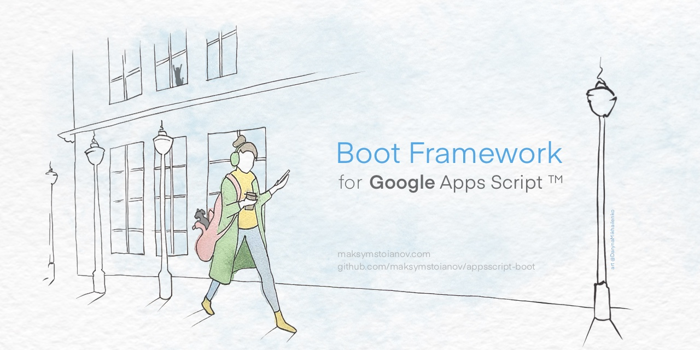

<a name="top"></a>



<p align="right">
    <small>
      <i>Художниця: <a href="https://darynamikhailenko.com/?utm_source=github&utm_medium=readme&utm_campaign=apps-script-boot&utm_content=banner-artist-credit" title="Portfolio of Daryna Mikhailenko, the artist">Daryna Mikhailenko</a></i>
    </small>
</p>

[English](../../README.md) | **Українська** | [Русский](README.ru.md) | [Deutsch](README.de.md) | [Français](README.fr.md) | [Español](README.es.md) | [Português](README.pt.md) | [Italiano](README.it.md) | [Nederlands](README.nl.md) | [Polski](README.pl.md) | [Čeština](README.cs.md) | [Türkçe](README.tr.md) | [العربية](README.ar.md) | [Bahasa Indonesia](README.id.md) | [Tiếng Việt](README.vi.md) | [日本語](README.ja.md) | [한국어](README.ko.md) | [简体中文](README.zh.md) | [繁體中文](README.zh-TW.md)

> Цей переклад підготовлено за допомогою ШІ на основі [README.md](../../README.md) для версії 1.10.0. Основною є англійська
> версія README. Виправлення вітаються — див. [CONTRIBUTING.md](../../CONTRIBUTING.md).

# Boot Framework for Google Apps Script™

<p align="left">
  <a href="https://github.com/google/clasp"></a>
  <a href="../../LICENSE"></a>
  <a href="../../SECURITY.md"></a>
  <a href="../../ROADMAP.md"></a>
  <a href="https://github.com/bootgs/boot/releases"></a>
</p>

<p align="left">
  <a href="https://github.com/bootgs/boot/stargazers"></a>
  <a href="https://github.com/bootgs/boot/forks"></a>
  <a href="https://github.com/sponsors/MaksymStoianov"></a>
</p>

## Вступ

**Boot.gs** — легкий фреймворк для створення структурованих застосунків на Google Apps Script. Він переносить у
середовище Apps Script звичні підходи до розробки, як-от декоратори та впровадження залежностей, щоб код було простіше
організувати.

Контролери не залежать від середовища: той самий код обробляє вебзапити `doGet`/`doPost`, виклики `google.script.run`
із бічних панелей і діалогів, а також події Google Workspace, наприклад `onOpen` чи `onEdit`.

## Можливості

- **Маршрутизація на декораторах**: зручне зіставлення HTTP-запитів і подій Apps Script (GET, POST тощо).
- **Патерни Spring Boot і NestJS**: знайомі декоратори `@RequestMapping`, `@RestController`, `@ResponseBody` і клас
  `ResponseEntity`.
- **Гнучкі відповіді**: повний контроль над HTTP-кодами статусу, заголовками й MIME-типами через `ResponseEntity`.
- **Валідація**: декларативна перевірка параметрів декораторами в стилі Spring Boot — `@Min`, `@Max`, `@Email` тощо.
- **Pipes і валідація**: перетворення та перевірка вхідних даних за допомогою `@UsePipes` і вбудованих pipes (наприклад,
  `ParseNumberPipe`).
- **Глобальна обробка помилок**: централізоване керування винятками через `@ControllerAdvice` і `@ExceptionHandler`.
- **Впровадження залежностей**: повноцінний DI для слабкої зв'язності й зручного тестування.
- **Типобезпека**: написано на TypeScript для надійної розробки.
- **Сучасна архітектура**: натхненна фреймворками NestJS і Spring Boot.

## Вимоги

- Проєкт Google Apps Script на середовищі виконання V8, зазвичай керований локально через [clasp](https://github.com/google/clasp).
- TypeScript з увімкненими `experimentalDecorators` і `emitDecoratorMetadata` у `tsconfig.json`.
- Node.js `>=22.14.0` і npm для встановлення та збирання.

## Встановлення

Встановіть фреймворк через npm:

```bash
npm install bootgs
```

## Швидкий старт

### 1. Створіть контролер

Створіть клас із логікою застосунку. Декоратори прив'язують методи до конкретних ендпоінтів або подій.

```TypeScript
import {Get, RestController} from "bootgs";

@RestController("api/sheet")
export class SheetController {
    /**
     * Handles GET requests to /api/sheet/active-range
     */
    @Get("active-range")
    getActiveRange(): string {
        return "This action returns the active sheet range.";
    }
}
```

### 2. Ініціалізуйте застосунок

Створіть екземпляр `App` і делегуйте йому стандартні точки входу Apps Script, щоб фреймворк міг перехоплювати та
маршрутизувати вхідні події.

```TypeScript
import {App} from "bootgs";
import {SheetController} from "./SheetController";

/**
 * Global entry point for GET requests.
 */
export function doGet(event: GoogleAppsScript.Events.DoGet) {
    const app = App.create({
        controllers: [SheetController]
    });
    return app.doGet(event);
}
```

Повний покроковий приклад, зокрема з `doPost` і асинхронним `AsyncApp`, — у
[посібнику Quick Start](../guide/quick-start.md) (англійською).

## Документація

Детальні посібники доступні англійською:

- [Quick Start](../guide/quick-start.md): налаштування синхронного `App` і асинхронного `AsyncApp`.
- [Calling the API (Virtual Transport Layer)](../guide/virtual-transport-layer.md): параметри запиту, MIME-типи,
  виклики через `google.script.run` і URL вебзастосунку, обгортання відповідей.
- [Decorators](../guide/decorators.md): декоратори класів, методів і параметрів, валідація та вбудовані pipes.
- [Controlling the Response](../guide/responses.md): `ResponseEntity` і `@ResponseBody`.
- [Advanced Examples](../guide/examples.md): pipes і глобальна обробка помилок.
- [AI Agent Skills](../guide/ai-agent-skills.md): повний список навичок і способи встановлення.
- [Boot.gs vs Spring Boot vs NestJS](../comparison.md): порівняння архітектур.

## Навички для ШІ-агентів

Працюєте з ШІ-агентом для програмування (Claude Code, Gemini CLI, Cursor тощо)? Репозиторій
**[bootgs/skills](https://github.com/bootgs/skills)** містить Agent Skills, які вчать агента створювати каркас,
структурувати й перевіряти застосунки **Boot.gs**, а також універсальні навички для розробки на Google Apps Script.

```bash
/plugin marketplace add bootgs/skills
/plugin install bootgs@bootgs-skills
```

Повний список і встановлення для Gemini CLI та `npx skills` — у розділі [AI Agent Skills](../guide/ai-agent-skills.md).

## Рекомендуємо

> [!TIP]
> Для зручнішої розробки на Google Apps Script радимо [@bootgs/utils](https://github.com/bootgs/utils) —
> набір утилітарних функцій і класів, що доповнюють цей фреймворк.

## Учасники

<a href="https://github.com/felipepmdias"></a>
<a href="https://github.com/kosmo-ds"></a>

## Як долучитися

Ми раді внескам! Правила спільноти та порядок подання pull request описано в [настановах для учасників](../../CONTRIBUTING.md).
Щоб повідомити про вразливість, дотримуйтеся [політики безпеки](../../SECURITY.md).

## Дорожня карта

Плани на наступні релізи — у [дорожній карті](../../ROADMAP.md).

## Журнал змін

Детальний перелік змін і оновлень — у [CHANGELOG](../../CHANGELOG.md).

## Підтримка

Питання та повідомлення про помилки — у [GitHub Issues](https://github.com/bootgs/boot/issues). Якщо проєкт вам
корисний, підтримайте його через [GitHub Sponsors](https://github.com/sponsors/MaksymStoianov) або
[Buy Me a Coffee](https://buymeacoffee.com/MaksymStoianov).

## Ліцензія

Проєкт поширюється за [ліцензією Apache-2.0](../../LICENSE).

---

<p align="center">
  ⭐ <b>Подобається проєкт?</b> Поставте зірку на <a href="https://github.com/bootgs/boot">GitHub</a>!
</p>
